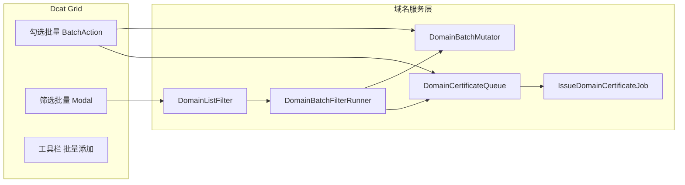

# 批量操作能力开发报告

> 版本：2026-10-28（分支 `cursor/domain-batch-ops-aae1`，PR #418 及后续提交）  
> 范围：301 主控后台（Laravel + Dcat Admin）— 域名、分组、节点

## 1. 目标与参考

对标 CDN / 边缘平台（如 CDNFly）常见的控制台能力：

- 列表多选 + 批量动作（启用、停用、修改、删除、证书相关）
- 大批量导入
- 按筛选条件批量处理（避免逐页勾选）
- 后台任务排队与速率限制（尤其 ACME）

## 2. 调研结论（改造前已有）

| 模块 | 能力 | 代码入口 |
|------|------|----------|
| 域名 | 批量添加（最多 500 行） | `BatchDomainModal` / `DomainBatchCreator` |
| 域名 | 批量申请证书 | `BatchApplyCertificate` → `DomainCertificateQueue` |
| 域名 | 批量重新下发证书 | `BatchRedeployCertificate` → `DomainCertificateRedeployQueue` |
| 域名 | 导出 CSV（与列表同筛选） | `DomainListCsvExporter` |
| 分组 | 按分组批量改跳转 URL | `UrlSetByGroup`（行内弹窗，非勾选） |
| 节点 | 行内重试失败证书、重置 Token | `RequeueNodeFailedCerts` / `RotateNodeToken` |
| 运维 | 全平台重试 failed 部署 | 节点列表工具栏 POST `ops/requeue-failed-deployments` |

### 证书批量与限速（既有设计）

1. **入队错开**：`DomainCertificateQueue` 对每个 `domain_id` 的 `IssueDomainCertificateJob` 递增 `delay($i * 20)` 秒。  
2. **全局串行 ACME**：`IssueDomainCertificateJob::middleware()` 使用 `WithoutOverlapping('redi-acme-le-global')`，多 worker 时需共享缓存（如 Redis）。  
3. **仅启用域名**：申请证书时 `where('status', 1)`。  
4. **运维要求**：`QUEUE_CONNECTION` 须为 `database` 或 `redis`，不宜长期 `sync`（见 `docs/CONSOLE.md`）。

## 3. 本次新增与增强

### 3.1 域名管理

**勾选批量（工具栏「批量」下拉）**

| 操作 | 类名 | 说明 |
|------|------|------|
| 批量启用 | `BatchEnableDomains` | `DomainBatchMutator::setStatusOwned(1)`，DNS 规则同单条表单 |
| 批量停用 | `BatchDisableDomains` | 确认后 `status=2`，走模型 `saved` 钩子清理挑战/部署 |
| 批量修改 | `BatchEditDomains` + 表单 | 跳转链接、分组、强制 HTTPS（留空=不改） |
| 批量申请证书 | （原有） | |
| 批量重新下发 | （原有） | |
| 批量删除 | `BatchDeleteDomains` | 删除域名及关联证书（模型 `deleting`） |

**工具栏（不依赖勾选）**

| 操作 | 类名 | 说明 |
|------|------|------|
| 按筛选批量操作 | `BatchFilterDomainModal` | 与 CSV 相同筛选键；单次最多 **500** 条 ID；支持申请证书/启用/停用/删除 |

**共享服务**

- `DomainBatchMutator`：启用、停用、改跳转、迁组、强制 HTTPS、删除；租户归属与平台管理员规则与单条编辑一致。  
- `DomainListFilter`：从请求参数构建列表查询（`group_id`、`original_url`、`skip_url`、`status`、`cert_filter`）。  
- `DomainBatchFilterRunner`：筛选批量动作分发。  
- `DomainListCsvExporter::filteredQuery()` 改为委托 `DomainListFilter`，避免筛选逻辑分叉。

**上限**

- 勾选批量与筛选批量：`DomainBatchMutator::MAX_IDS_PER_BATCH = 500`（与批量添加行数一致）。

### 3.2 分组管理

| 操作 | 类名 | 说明 |
|------|------|------|
| 批量启用 | `BatchEnableGroups` | `GroupBatchMutator` |
| 批量停用 | `BatchDisableGroups` | 停用后新建域名不可选该分组 |
| 批量删除 | `BatchDeleteGroups` | 仅空分组可删（模型校验） |

保留原有：**行内「批量修改跳转」**（按分组整组改 `skip_url`）。

### 3.3 节点管理（仅超级管理员）

| 操作 | 类名 | 说明 |
|------|------|------|
| 批量启用 | `BatchEnableNodes` | 触发 `CertificateDeployService::syncDeploymentsForNode` |
| 批量停用 | `BatchDisableNodes` | 触发 `handleNodeDisabled` |
| 批量重试失败证书 | `BatchRequeueNodeFailedCerts` | 按节点调用 `requeueFailedDeployments` |
| 批量重置 Token | `BatchRotateNodeTokens` | 单次最多 **20** 节点；成功消息含明文 Token（与单行重置一致，需立即下发） |

`NodeBatchMutator::MAX_IDS_PER_BATCH = 100`（启用/停用/重试）；Token 旋转单独 cap 20。

## 4. 架构示意



## 5. 国际化

文案键位于：

- `resources/lang/*/redi-admin-domain.php`（含 `batch_filter`、`batch_delete`）
- `resources/lang/*/redi-admin-group.php`（`actions.batch_*`）
- `resources/lang/*/redi-admin-node.php`（`actions.batch_*`）

语言：zh_CN、zh_TW、en。

## 6. 测试

| 测试类 | 覆盖点 |
|--------|--------|
| `DomainBatchMutatorTest` | 启用/停用、跳转、迁组、强制 HTTPS |
| `DomainCertificateQueueTest` | 租户与启用状态过滤 |
| `DomainListFilterTest` | 筛选 ID 解析 |
| `NodeBatchMutatorTest` | 批量停用节点 |
| `DomainBatchCreatorTest` | 批量添加与 DNS 启用校验 |

本地/CI：`cd master/master && composer install && ./vendor/bin/phpunit`

## 7. 刻意未做 / 后续可增强

| 项 | 原因 / 建议 |
|----|-------------|
| 跨页「全选全部记录」而不限 500 | 需异步任务 + 进度条；当前用「按筛选批量」覆盖大部分场景 |
| 筛选批量：批量修改弹窗字段 | 交互复杂；勾选「批量修改」或分组级改跳转仍可用 |
| 筛选批量：重新下发证书 | 可复用 `DomainCertificateRedeployQueue`，按需加 action |
| 节点批量改 IP / 备注 | 无统一校验 UI；仍建议单行编辑 |
| 平台 DNS / 设置页批量 | 非列表型资源，不在本次范围 |
| 租户侧节点操作 | 节点列表本身仅管理员可进（`EnsuresAdministrator`） |

## 8. 使用提示（运营）

1. **按筛选批量**：先点列表「搜索」使 URL 带上筛选参数，再点「按筛选批量操作」。  
2. **批量证书**：确认 `redi-queue` 运行、节点在线、解析预检通过。  
3. **批量重置 Token**：务必在成功提示中复制各节点 Token，旧 Token 立即失效。  
4. **删除分组**：先迁走或删除组内域名。

## 9. 变更文件索引（核心）

```
master/master/app/Services/DomainBatchMutator.php
master/master/app/Services/DomainListFilter.php
master/master/app/Services/DomainBatchFilterRunner.php
master/master/app/Services/NodeBatchMutator.php
master/master/app/Services/GroupBatchMutator.php
master/master/app/Admin/Controllers/RediAdminDomainController.php
master/master/app/Admin/Controllers/RediAdminGroupController.php
master/master/app/Admin/Controllers/RediNodeController.php
master/master/app/Admin/Actions/Grid/Batch*.php
master/master/app/Admin/Actions/Modal/BatchFilterDomainModal.php
master/master/app/Admin/Forms/BatchEditDomains.php
master/master/app/Admin/Forms/BatchFilterDomains.php
docs/CONSOLE.md
docs/BATCH-OPERATIONS-REPORT.md
```

## 10. 代码复核记录（2026-10-28）

| 级别 | 项 | 处理 |
|------|-----|------|
| 高 | 批量迁组未同步 `redi_domain_cert.admin_id` / 部署对齐 | 已抽 `DomainCertificateAdminSync`，迁组后与单条表单保存一致 |
| 高 | 「按筛选批量」无筛选时会对前 500 条做停用/删除 | 停用/删除强制 `DomainListFilter::hasAnyFilter`；表单增加二次确认 |
| 中 | 批量删除异常向用户暴露原始异常信息 | 非校验类异常改为通用「保存失败」文案 |
| 中 | `DomainBatchMutator` 重复 docblock | 已删除 |
| 低 | 按筛选批量未覆盖「批量修改」 | 仍用勾选「批量修改」 |
| 已做 | 勾选或筛选超过 500 条 | 成功提示追加 `truncated_suffix`，请分批再操作 |
| 已做 | 按筛选批量「重新下发证书」 | `DomainBatchFilterRunner` + 筛选弹窗选项 |
| 已修 | `applyEditsOwned` 的 `updated` 计数 | 按 **唯一域名数** 统计（`mergeEditResults` + `changed_ids`） |
| 已修 | 节点批量重试计数语义 | `updated` = 节点数，`deployments_requeued` = 部署条数；提示文案区分二者 |

## 11. 二次复核（截断 + 筛选重新下发后）

| 结论 | 说明 |
|------|------|
| 通过 | 域名 500 上限与 `truncated_suffix`；筛选 `matched/truncated` 与勾选 limiter 分工正确，未见双重计数 |
| 通过 | 筛选停用/删除须 `hasAnyFilter`；迁组后 `DomainCertificateAdminSync` 已接 |
| 通过 | `dispatchOwned` / `redeployOwned` 返回 `truncated`；单测含 limiter、filter 删除守卫、筛选截断 |
| 已修 | 无筛选仍可按筛选做申请/重新下发/启用（最多 500） | 成功提示追加 `batch_filter.warnings.unfiltered` |
| 已修 | 分组（200）、节点（100）批量静默截断 | `AppendsGroupBatchTruncationNotice` / `AppendsNodeBatchTruncationNotice` |
| 待 CI | 云环境无 PHP，合并前请跑 `master/master` 全量 `phpunit` |

## 12. 第三轮（能修的都搞一下）

| 项 | 处理 |
|----|------|
| `applyEditsOwned` 三次 normalize | 单次 `normalizeOwnedIds`，迁组/跳转/HTTPS 走 `apply*OnOwnedIds` |
| 分组批量异常文案 | `ValidationException` 保留字段错误；其它异常用 `save_failed`，不暴露原文 |
| 分组 `GroupBatchMutator` | 接入 `BatchSelectionLimiter`（200），结果带 `truncated` |
| 节点 `NodeBatchMutator` | 勾选 ID 规范化返回 `truncated`；Token 批量仍 cap 20 |
| i18n | `batch_filter.warnings.unfiltered`（中/英/繁）；分组 `save_failed`（中/英/繁） |
| 单测 | 新增 `GroupBatchMutatorTest` |

**合并建议**：无阻塞项；建议 smoke：勾选 >500 域名、>200 分组、>100 节点，无筛选按筛选批量申请证书看警告文案。

## 13. 语义修正 + 审计日志

| 项 | 处理 |
|----|------|
| 批量修改 `updated` | 多字段同时改同一域名只计 1 |
| 节点批量重试 | 成功提示「:nodes 个节点 / :deployments 条部署」 |
| 审计 | `AdminBatchOperationAudit` → `storage/logs/admin-batch.log`（30 天 daily） |
| 覆盖范围 | 域名/分组/节点勾选批量、批量修改、**批量添加**、按筛选批量（含证书申请/重新下发） |
| 安全 | 日志仅 ID 抽样；Token 批量标记 `sensitive`，不写入明文 |

## 14. 四轮复核（语义 + 审计后）

| 级别 | 项 | 结论 |
|------|-----|------|
| 通过 | 租户隔离 | 各 `*Owned` / `normalizeOwnedIds` 仍按 `admin_id` 或超管放行；勾选 ID 与筛选 ID 均二次过滤 |
| 通过 | 破坏性筛选 | 停用/删除仍须 `DomainListFilter::hasAnyFilter` |
| 通过 | 批量修改 `updated` | `mergeEditResults` 对 `changed_ids` 去重；单测覆盖三字段同域 |
| 通过 | 节点批量重试 | `updated`=节点数、`deployments_requeued`=部署数；审计 `metricsFromMutator` 带两字段 |
| 通过 | 证书批量 | 20s 错峰 + 全局 ACME 锁未动；筛选/勾选 `truncated` 叠加逻辑正确（筛选已 cap 500 时 dispatch 侧 truncated 通常为 0） |
| 通过 | 审计覆盖 | 域名/分组/节点勾选批量、批量修改、按筛选五类动作（含 cert/redeploy）成功即写 `admin_batch` |
| 通过 | 审计安全 | 不记 Token/筛选值；勾选模式有 `id_sample`（≤25） |
| 已修 | 批量修改 `skipped` | §15：`skipped_ids` 去重，已变更域名不计入跳过 |
| 低风险 | 按筛选审计 | 无 `id_sample`，仅 `filter_keys` + 条数；追溯依赖当时列表筛选条件 |
| 已修 | 批量添加域名审计 | §15：`batch_create`；分组行 **按组改跳转** → §16 `url_set_by_group` |
| 待 CI | 单测 | 云环境无 PHP；合并前跑全量 `phpunit`（含 `AdminBatchOperationAuditTest`） |

**合并建议**：无阻塞；合并后抽一条勾选批量与一条按筛选批量，确认 `storage/logs/admin-batch.log` 有对应记录。

## 15. 批量修改 skipped + 批量添加审计

| 项 | 处理 |
|----|------|
| `applyEditsOwned` `skipped` | 各字段 `skipped_ids` 合并去重，并减去已变更域名 |
| 单测 | `test_apply_edits_skipped_counts_unique_domains` |
| 批量添加域名 | `BatchCreateDomains` → `auditBatchCreateDomains`（`action=batch_create`，不记录 lines 正文） |

## 16. 分组按组改跳转审计

| 项 | 处理 |
|----|------|
| 入口 | `UrlSetByGroup` 行操作 |
| 审计 | `group.url_set_by_group`，`updated`/`skipped` 为组内域名数（不含跳转 URL 正文） |
| 计数 | 更新前区分已相同 `skip_url` 与待更新行 |

## 17. 五轮复核（skipped 去重 + 批量添加/按组改跳转审计）

**范围**：提交 `523d96a`～`343814b`（`skipped_ids`、`batch_create`、`url_set_by_group`）。

| 级别 | 项 | 结论 |
|------|-----|------|
| 通过 | `mergeEditResults` | `skipped_ids` 并集去重后减去 `changed_ids`；与 `updated` 语义一致 |
| 通过 | 单测 | `test_apply_edits_skipped_counts_unique_domains` 覆盖三字段均已达标 |
| 通过 | `batch_create` 审计 | 仅成功路径（`imported` 或 `skipped`>0）；`updated` 映射 `imported`；不记 `lines` |
| 通过 | `url_set_by_group` | 租户校验未改；计数与 `update` 条件一致；不记 URL 正文 |
| 通过 | 空分组按组改跳转 | `updated=0, skipped=0` 仍成功并写审计（可追溯「点过但无域名」） |
| 低风险 | `UrlSetByGroup` 写库 | 仍为 `DB::update`，不走模型校验（改前即如此；与勾选批量修改校验路径不一致） |
| 低风险 | `skip_url !=` 条件 | 依赖库对 NULL/大小写比较；生产数据若 `skip_url` 恒为非空规范化 URL 则无影响 |
| 低风险 | 批量修改全跳过 | `updated=0` 且仅 `skipped>0` 时仍报「无变更」、**不写** `batch_edit` 审计（原 UX） |
| 待 CI | 单测 | 未新增 UrlSetByGroup / BatchCreate 审计单测；合并前跑全量 `phpunit` |

**合并建议**：无阻塞。Smoke：批量添加 2 条（含 1 重复）→ 日志 `batch_create`；分组行改跳转 → `url_set_by_group`；批量修改三字段不变 → 提示跳过数为 **1**。

---

**总结**：项目在证书批量与排队方面原先已完备；本次把 **域名 / 分组 / 节点** 的高频批量运维补齐，并增加 **按筛选批量** 与 **文件审计** 以减轻多页勾选成本并留痕。更大规模编排仍适合后续用队列任务 + 后台可查的审计表扩展。
