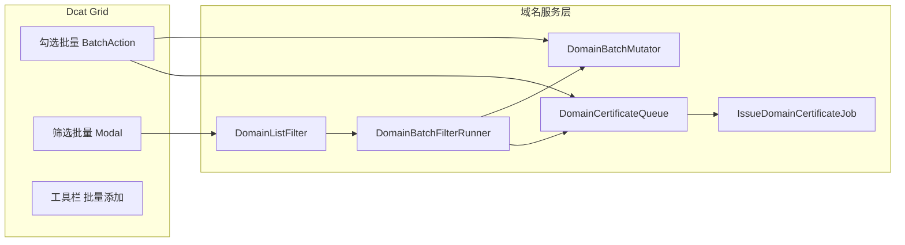

# 批量操作能力开发报告

> 版本：2026-10-28（分支 `cursor/domain-batch-ops-aae1`，PR #418 及后续提交）  
> 范围：301 主控后台（Laravel + Dcat Admin）— 域名、分组、节点

## 1. 目标与参考

对标 CDN / 边缘平台（如 CDNFly）常见的控制台能力：

- 列表多选 + 批量动作（启用、停用、修改、删除、证书相关）
- 大批量导入
- 按筛选条件批量处理（避免逐页勾选）
- 后台任务排队与速率限制（尤其 ACME）

## 2. 调研结论（改造前已有）

| 模块 | 能力 | 代码入口 |
|------|------|----------|
| 域名 | 批量添加（最多 500 行） | `BatchDomainModal` / `DomainBatchCreator` |
| 域名 | 批量申请证书 | `BatchApplyCertificate` → `DomainCertificateQueue` |
| 域名 | 批量重新下发证书 | `BatchRedeployCertificate` → `DomainCertificateRedeployQueue` |
| 域名 | 导出 CSV（与列表同筛选） | `DomainListCsvExporter` |
| 分组 | 按分组批量改跳转 URL | `UrlSetByGroup`（行内弹窗，非勾选） |
| 节点 | 行内重试失败证书、重置 Token | `RequeueNodeFailedCerts` / `RotateNodeToken` |
| 运维 | 全平台重试 failed 部署 | 节点列表工具栏 POST `ops/requeue-failed-deployments` |

### 证书批量与限速（既有设计）

1. **入队错开**：`DomainCertificateQueue` 对每个 `domain_id` 的 `IssueDomainCertificateJob` 递增 `delay($i * 20)` 秒。  
2. **全局串行 ACME**：`IssueDomainCertificateJob::middleware()` 使用 `WithoutOverlapping('redi-acme-le-global')`，多 worker 时需共享缓存（如 Redis）。  
3. **仅启用域名**：申请证书时 `where('status', 1)`。  
4. **运维要求**：`QUEUE_CONNECTION` 须为 `database` 或 `redis`，不宜长期 `sync`（见 `docs/CONSOLE.md`）。

## 3. 本次新增与增强

### 3.1 域名管理

**勾选批量（工具栏「批量」下拉）**

| 操作 | 类名 | 说明 |
|------|------|------|
| 批量启用 | `BatchEnableDomains` | `DomainBatchMutator::setStatusOwned(1)`，DNS 规则同单条表单 |
| 批量停用 | `BatchDisableDomains` | 确认后 `status=2`，走模型 `saved` 钩子清理挑战/部署 |
| 批量修改 | `BatchEditDomains` + 表单 | 跳转链接、分组、强制 HTTPS（留空=不改） |
| 批量申请证书 | （原有） | |
| 批量重新下发 | （原有） | |
| 批量删除 | `BatchDeleteDomains` | 删除域名及关联证书（模型 `deleting`） |

**工具栏（不依赖勾选）**

| 操作 | 类名 | 说明 |
|------|------|------|
| 按筛选批量操作 | `BatchFilterDomainModal` | 与 CSV 相同筛选键；单次最多 **500** 条 ID；支持申请证书/启用/停用/删除 |

**共享服务**

- `DomainBatchMutator`：启用、停用、改跳转、迁组、强制 HTTPS、删除；租户归属与平台管理员规则与单条编辑一致。  
- `DomainListFilter`：从请求参数构建列表查询（`group_id`、`original_url`、`skip_url`、`status`、`cert_filter`）。  
- `DomainBatchFilterRunner`：筛选批量动作分发。  
- `DomainListCsvExporter::filteredQuery()` 改为委托 `DomainListFilter`，避免筛选逻辑分叉。

**上限**

- 勾选批量与筛选批量：`DomainBatchMutator::MAX_IDS_PER_BATCH = 500`（与批量添加行数一致）。

### 3.2 分组管理

| 操作 | 类名 | 说明 |
|------|------|------|
| 批量启用 | `BatchEnableGroups` | `GroupBatchMutator` |
| 批量停用 | `BatchDisableGroups` | 停用后新建域名不可选该分组 |
| 批量删除 | `BatchDeleteGroups` | 仅空分组可删（模型校验） |

保留原有：**行内「批量修改跳转」**（按分组整组改 `skip_url`）。

### 3.3 节点管理（仅超级管理员）

| 操作 | 类名 | 说明 |
|------|------|------|
| 批量启用 | `BatchEnableNodes` | 触发 `CertificateDeployService::syncDeploymentsForNode` |
| 批量停用 | `BatchDisableNodes` | 触发 `handleNodeDisabled` |
| 批量重试失败证书 | `BatchRequeueNodeFailedCerts` | 按节点调用 `requeueFailedDeployments` |
| 批量重置 Token | `BatchRotateNodeTokens` | 单次最多 **20** 节点；成功消息含明文 Token（与单行重置一致，需立即下发） |

`NodeBatchMutator::MAX_IDS_PER_BATCH = 100`（启用/停用/重试）；Token 旋转单独 cap 20。

## 4. 架构示意



## 5. 国际化

文案键位于：

- `resources/lang/*/redi-admin-domain.php`（含 `batch_filter`、`batch_delete`）
- `resources/lang/*/redi-admin-group.php`（`actions.batch_*`）
- `resources/lang/*/redi-admin-node.php`（`actions.batch_*`）

语言：zh_CN、zh_TW、en。

## 6. 测试

| 测试类 | 覆盖点 |
|--------|--------|
| `DomainBatchMutatorTest` | 启用/停用、跳转、迁组、强制 HTTPS |
| `DomainCertificateQueueTest` | 租户与启用状态过滤 |
| `DomainListFilterTest` | 筛选 ID 解析 |
| `NodeBatchMutatorTest` | 批量停用节点 |
| `DomainBatchCreatorTest` | 批量添加与 DNS 启用校验 |

本地/CI：`cd master/master && composer install && ./vendor/bin/phpunit`

## 7. 刻意未做 / 后续可增强

| 项 | 原因 / 建议 |
|----|-------------|
| 跨页「全选全部记录」而不限 500 | 需异步任务 + 进度条；当前用「按筛选批量」覆盖大部分场景 |
| 筛选批量：批量修改弹窗字段 | 交互复杂；勾选「批量修改」或分组级改跳转仍可用 |
| 筛选批量：重新下发证书 | 可复用 `DomainCertificateRedeployQueue`，按需加 action |
| 节点批量改 IP / 备注 | 无统一校验 UI；仍建议单行编辑 |
| 平台 DNS / 设置页批量 | 非列表型资源，不在本次范围 |
| 租户侧节点操作 | 节点列表本身仅管理员可进（`EnsuresAdministrator`） |

## 8. 使用提示（运营）

1. **按筛选批量**：先点列表「搜索」使 URL 带上筛选参数，再点「按筛选批量操作」。  
2. **批量证书**：确认 `redi-queue` 运行、节点在线、解析预检通过。  
3. **批量重置 Token**：务必在成功提示中复制各节点 Token，旧 Token 立即失效。  
4. **删除分组**：先迁走或删除组内域名。

## 9. 变更文件索引（核心）

```
master/master/app/Services/DomainBatchMutator.php
master/master/app/Services/DomainListFilter.php
master/master/app/Services/DomainBatchFilterRunner.php
master/master/app/Services/NodeBatchMutator.php
master/master/app/Services/GroupBatchMutator.php
master/master/app/Admin/Controllers/RediAdminDomainController.php
master/master/app/Admin/Controllers/RediAdminGroupController.php
master/master/app/Admin/Controllers/RediNodeController.php
master/master/app/Admin/Actions/Grid/Batch*.php
master/master/app/Admin/Actions/Modal/BatchFilterDomainModal.php
master/master/app/Admin/Forms/BatchEditDomains.php
master/master/app/Admin/Forms/BatchFilterDomains.php
docs/CONSOLE.md
docs/BATCH-OPERATIONS-REPORT.md
```

---

**总结**：项目在证书批量与排队方面原先已完备；本次把 **域名 / 分组 / 节点** 的高频批量运维补齐，并增加 **按筛选批量** 以减轻多页勾选成本。更大规模或跨模块编排适合后续用队列任务 + 审计日志扩展。
