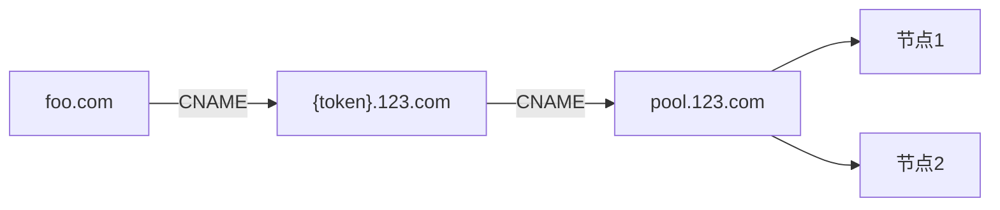
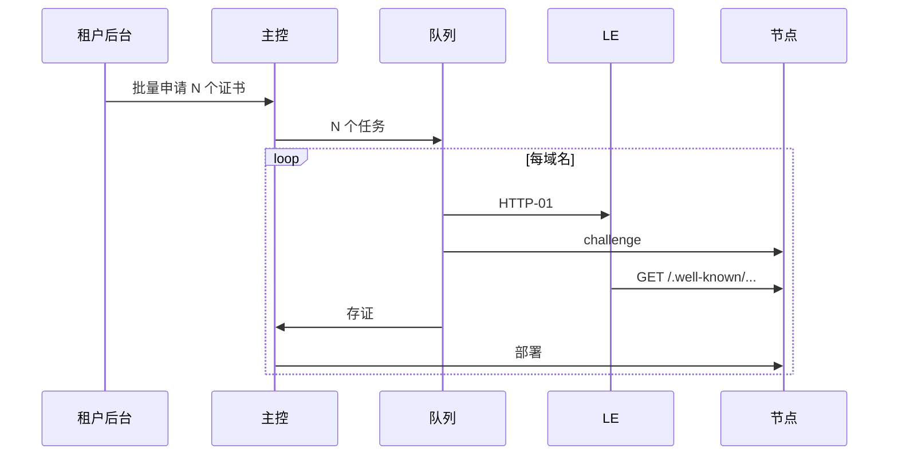

# 一期开发规格与进度：边缘 CNAME（模型 2）+ 证书一键（HTTP-01）+ 全平台节点池

> **原则**：**一期做完**，不按多期拆分上线。进度在 **§八** 勾选；请你确认的范围在 **§零**。  
> **路径**：`docs/DEVELOPMENT-EDGE-POOL-HTTPS.md`

---

## 零、请你确认的范围清单（回复「确认」或逐条修改）

| # | 确认项 | 规格（一期） |
|---|--------|----------------|
| 1 | 交付形态 | **单期交付**，下列功能同一版本验收 |
| 2 | 客户添加的域名 | **主域名**（如 `foo.com`） |
| 3 | 租户 CNAME | 平台 zone（如 `123.com`）+ 随机 token → **`{token}.123.com`**；**同一用户下所有域名共用此 CNAME 目标** |
| 4 | DNS 模型 | **模型 2**：`{token}.123.com` CNAME → **`pool.123.com`**；**只在 pool 上挂全部节点 A** |
| 5 | 节点池 | **全平台一个池**；后台维护节点公网 IP |
| 6 | pool 解析 | **手动 + DNS API 都保留**；API 用节点列表同步 pool 的 A |
| 7 | DNS API 厂商 | Cloudflare、阿里云（中/国际）、DNSPod（中/国际）、dns.com |
| 8 | 证书编排 | **方案 C**：主控 ACME、加密存证、下发全部启用节点 |
| 9 | 证书验证 | **仅 HTTP-01 一键**（类似 CDNFly）；客户 **只做 CNAME**；**不要 NS 委托、不要逐域 TXT** |
| 10 | 域名很多 | **批量申请证书** + **队列续期**；**一期不开发**「客户逐个加 TXT」流程 |
| 11 | lagran | **80 + 443** |
| 12 | 节点连库 | 仍直连 MySQL（`REDI_DB_*`） |
| 13 | 数据库 | 新表合并进 **`db/redi_admin.sql` 全量**（全新库导入） |

**当前整体进度**：`0 / 52`（见 §八）

---

## 一、总结

### 1.1 两个问题在一期里怎么解决

| 问题 | 一期做法 |
|------|----------|
| **4 — 域名接到所有节点** | 客户 `foo.com` CNAME → `{token}.平台域`；你方 token→pool，pool→多 A；主控展示 + 可选 API |
| **3 — HTTPS** | CNAME 生效后 **申请证书**（支持 **批量**）；**HTTP-01**；主控发证并推到 **所有节点**；443 跳转 |

### 1.2 证书：域名多，为什么不能靠 TXT

- 逐域 TXT **不可运营** → 一期 **主路径只有 HTTP-01**（与 CDNFly 同类）。  
- 客户为跳转已做 **CNAME**；证书 **复用同一解析**，后台 **一键 / 批量申请** + **自动续期**，无需再改 DNS。  
- **不做** NS 委托；**一期不做** 客户 DNS API、**不做** 批量 TXT UI。  
- 个别注册商根域不能 CNAME：仅 **帮助文档** 说明 ALIAS 等，系统不主打 TXT。

### 1.3 分工

| 角色 | 操作 |
|------|------|
| 超管 | zone、pool、DNS 手动/API、节点 IP、同步 pool |
| 租户 | 加主域名；复制 CNAME 目标；**批量/单个申请证书**；可选强制 HTTPS |
| 客户 | 仅 DNS：CNAME（无 TXT、无 NS） |

---

## 二、架构

### 2.1 DNS（模型 2）

### 2.2 证书 HTTP-01（可批量）

---

## 三、数据模型

| 表 | 说明 |
|----|------|
| `redi_platform_dns` | zone、pool、manual/api、driver、credentials |
| `redi_nodes` | IP、enabled、token、heartbeat |
| `redi_tenant_edge` | admin_id、token、edge_fqdn |
| `redi_domain_certs` | domain_id、status、expires、加密 pem |
| `redi_cert_deployments` | cert_id、node_id、status |
| `redi_admin_domain` | + force_https、证书状态展示 |

---

## 四、后台功能（一期）

- **DNS 与节点池**、**节点管理**（超管）  
- **域名管理**：CNAME、**申请证书**、**批量申请**、状态、强制 HTTPS  
- **批量证书**：多选入队、预检 CNAME、异步 Job、续期 cron  

DNS 驱动：manual、cloudflare、aliyun_cn/intl、dnspod_cn/intl、dns_com。

---

## 五、节点（redi-multi）

- Agent：注册、心跳、HTTP-01（`/.well-known/` 优先）、拉证书  
- 443 SNI；lagran 80/443；HTTPS 跳转无混合内容；可选 80→443  

---

## 六、主控 ↔ 节点 API（草案）

- `POST /api/nodes/register`、`POST .../heartbeat`  
- `GET .../acme-challenges`、`GET .../certificates`、`POST .../ack`  

---

## 七、一期明确不做

NS 委托；多节点池；**逐域 TXT 主流程**；客户 DNS API；主控替代 MySQL 拉跳转规则。

---

## 八、任务进度（52 项）

### A. 主控基础（8）

- [ ] A1 表结构 + `redi_admin.sql`  
- [ ] A2 Model/Service  
- [ ] A3 菜单权限  
- [ ] A4 DNS/pool 页  
- [ ] A5 节点 CRUD  
- [ ] A6 租户 token  
- [ ] A7 CNAME 展示复制  
- [ ] A8 CNAME 预检 dig  

### B. DNS API（9）

- [ ] B1 Provider 接口 + 工厂  
- [ ] B2 Cloudflare  
- [ ] B3 阿里云中国  
- [ ] B4 阿里云国际  
- [ ] B5 DNSPod 中国  
- [ ] B6 DNSPod 国际  
- [ ] B7 dns.com  
- [ ] B8 同步 pool A + tenant CNAME  
- [ ] B9 同步日志  

### C. 证书 HTTP-01（9）

- [ ] C1 状态机  
- [ ] C2 单域申请  
- [ ] C3 **批量申请队列**  
- [ ] C4 挑战与验证  
- [ ] C5 存储加密  
- [ ] C6 续期 cron  
- [ ] C7 节点 API  
- [ ] C8 强制 HTTPS  
- [ ] C9 列表状态展示  

### D. 节点（8）

- [ ] D1–D8 Agent、well-known、TLS、lagran、跳转、打包  

### E. 文档（3）

- [ ] E1 DEPLOY 系列  
- [ ] E2 SECURITY  
- [ ] E3 客户帮助（CNAME，无 TXT 流程）  

### F. 验收（8）

- [ ] F1–F3 DNS 与 HTTP 跳转  
- [ ] F4 单域证书 HTTPS  
- [ ] F5 **批量 10+ 域证书**  
- [ ] F6–F8 强制 HTTPS、续期、新节点  

---

## 九、修订记录

| 日期 | 说明 |
|------|------|
| 2026-03-28 | 初稿 + HTTP-01；§零 确认清单；52 项；不做逐域 TXT |
