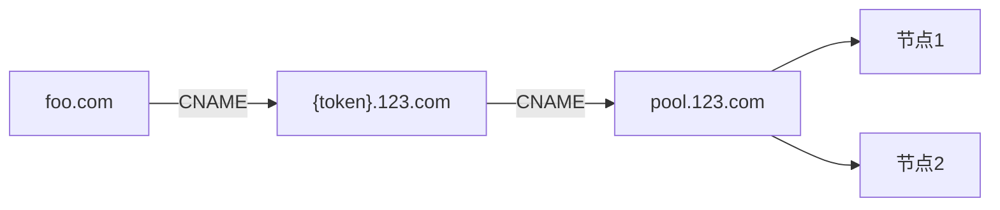
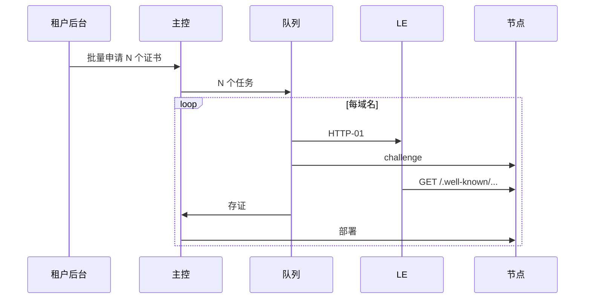

# 一期开发规格与进度：边缘 CNAME（模型 2）+ 证书一键（HTTP-01）+ 全平台节点池

> **原则**：**一期做完**，不按多期拆分上线。进度在 **§八** 勾选；请你确认的范围在 **§零**。  
> **路径**：`docs/DEVELOPMENT-EDGE-POOL-HTTPS.md`

---

## 零、请你确认的范围清单（回复「确认」或逐条修改）

| # | 确认项 | 规格（一期） |
|---|--------|----------------|
| 1 | 交付形态 | **单期交付**，下列功能同一版本验收 |
| 2 | 客户添加的域名 | **主域名**（如 `foo.com`） |
| 3 | 租户 CNAME | 平台 zone（如 `123.com`）+ 随机 token → **`{token}.123.com`**；**同一用户下所有域名共用此 CNAME 目标** |
| 4 | DNS 模型 | **模型 2**：`{token}.123.com` CNAME → **`pool.123.com`**；**只在 pool 上挂全部节点 A** |
| 5 | 节点池 | **全平台一个池**；后台维护节点公网 IP |
| 6 | pool 解析 | **手动 + DNS API 都保留**；API 用节点列表同步 pool 的 A |
| 7 | DNS API 厂商 | Cloudflare、阿里云（中/国际）、DNSPod（中/国际）、dns.com |
| 8 | 证书编排 | **方案 C**：主控 ACME、加密存证、下发全部启用节点 |
| 9 | 证书验证 | **仅 HTTP-01 一键**（类似 CDNFly）；客户 **只做 CNAME**；**不要 NS 委托、不要逐域 TXT** |
| 10 | 域名很多 | **批量申请证书** + **队列续期**；**一期不开发**「客户逐个加 TXT」流程 |
| 11 | lagran | **80 + 443** |
| 12 | 节点连库 | 仍直连 MySQL（`REDI_DB_*`） |
| 13 | 数据库 | 新表合并进 **`db/redi_admin.sql` 全量**（全新库导入） |

**当前整体进度**：`37 / 45`（见 §八；**F1–F8 需在环境执行** [ACCEPTANCE-EDGE-POOL.md](ACCEPTANCE-EDGE-POOL.md) 后勾选）

---

## 一、总结

### 1.1 两个问题在一期里怎么解决

| 问题 | 一期做法 |
|------|----------|
| **4 — 域名接到所有节点** | 客户 `foo.com` CNAME → `{token}.平台域`；你方 token→pool，pool→多 A；主控展示 + 可选 API |
| **3 — HTTPS** | CNAME 生效后 **申请证书**（支持 **批量**）；**HTTP-01**；主控发证并推到 **所有节点**；443 跳转 |

### 1.2 证书：域名多，为什么不能靠 TXT

- 逐域 TXT **不可运营** → 一期 **主路径只有 HTTP-01**（与 CDNFly 同类）。  
- 客户为跳转已做 **CNAME**；证书 **复用同一解析**，后台 **一键 / 批量申请** + **自动续期**，无需再改 DNS。  
- **不做** NS 委托；**一期不做** 客户 DNS API、**不做** 批量 TXT UI。  
- 个别注册商根域不能 CNAME：仅 **帮助文档** 说明 ALIAS 等，系统不主打 TXT。

### 1.3 分工

| 角色 | 操作 |
|------|------|
| 超管 | zone、pool、DNS 手动/API、节点 IP、同步 pool |
| 租户 | 加主域名；复制 CNAME 目标；**批量/单个申请证书**；可选强制 HTTPS |
| 客户 | 仅 DNS：CNAME（无 TXT、无 NS） |

---

## 二、架构

### 2.1 DNS（模型 2）

### 2.2 证书 HTTP-01（可批量）

---

## 三、数据模型

| 表 | 说明 |
|----|------|
| `redi_platform_dns` | zone、pool、manual/api、driver、credentials |
| `redi_nodes` | IP、enabled、token、heartbeat |
| `redi_tenant_edge` | admin_id、token、edge_fqdn |
| `redi_domain_certs` | domain_id、status、expires、加密 pem |
| `redi_cert_deployments` | cert_id、node_id、status |
| `redi_admin_domain` | + force_https、证书状态展示 |

---

## 四、后台功能（一期）

- **DNS 与节点池**、**节点管理**（超管）  
- **域名管理**：CNAME、**申请证书**、**批量申请**、状态、强制 HTTPS  
- **批量证书**：多选入队、预检 CNAME、异步 Job、续期 cron  

DNS 解析模式：

| 模式 | 后台行为 | 你在 DNS 厂商侧 |
|------|----------|-----------------|
| **手动**（默认） | 展示 **Pool A** 与 **各租户 token→pool CNAME** 参考表；**不显示**「同步」按钮 | 按表自行添加/更新记录 |
| **API 自动** | 配置驱动与凭证后，可 **一键同步** pool 多 A + 租户 CNAME | 以厂商面板为准做抽查 |

驱动（仅 API 模式使用）：cloudflare、aliyun_cn/intl、dnspod_cn/intl、dns_com；`manual` 表示不调用 API。

---

## 五、节点（redi-multi）

### 5.1 进程与端口

- 主进程仍连 **MySQL**（`REDI_DB_*` / `env.sh`）提供跳转与 `api.js`；**边缘池能力**由内置 **masteragent** 与主控 API 协作。
- **HTTP 跳转**：`config.json` 的 `addr`（默认 `0.0.0.0:80`）；可用环境变量 `REDI_HTTP_LISTEN` 覆盖。
- **HTTPS**：`tls_addr`（默认 `0.0.0.0:443`）；设为 `""` / `null` 或 `REDI_TLS_LISTEN=` 可关闭；证书由 Agent 拉取后 **SNI** 热加载。
- **lagran**：`lagran.port` 建议 **`80,443`**（可与 `addr` / `tls_addr` 自动合并）；需 root/CAP_NET_ADMIN。
- **管理 API**：`8080` 仍可直接访问 `api.js` / `c.js`（明文）。跳转页改为**当前域名相对路径** `/c.js`、`/api.js`，由 80/443 直接输出，HTTPS 不再请求 `https://IP:8080`。

### 5.2 Master Agent（`REDI_MASTER_URL` + `REDI_NODE_TOKEN`）

约 **5 秒** 一轮（缺 env 则 Agent 不启动）：

1. `POST /api/nodes/register`（仅版本号；**不能**改节点公网 IP 或名称）  
2. `GET /api/nodes/revision`；与上次相同则只心跳  
3. 有变化时：`GET /api/nodes/acme-challenges`（有挑战则必须 `POST /api/nodes/challenges-synced` 成功，失败则下轮重试）、`GET /api/nodes/redirect-rules`、`GET /api/nodes/certificates`（安装成功才 `POST /api/nodes/ack`）  
4. `POST /api/nodes/heartbeat`  

### 5.3 请求处理顺序（80/443）

1. `/.well-known/acme-challenge/*` **明文 200**（优先于跳转）  
2. `/c.js`、`/api.js` 由本进程输出（与 8080 相同逻辑）  
3. HTTP 且（证书或规则）**强制 HTTPS** → **301** 到 `https://`  
4. 否则返回跳转 HTML（相对路径加载 `/c.js`、`/api.js`）

打包：`./scripts/build-node-tar.sh` → `node/redi-multi.tar.gz`；说明见 `node/README.md`。

---

## 六、主控 ↔ 节点 API

- **鉴权**：`Authorization: Bearer {节点ID}.{创建时展示的 Secret}`（与 Dcat 后台会话无关）。  
- **前缀**：`/api/nodes/*`（见 `master/routes/api.php`）。

| 方法 | 路径 | 说明 |
|------|------|------|
| POST | `/register` | 登记心跳与版本；忽略 body 中的 IP/名称 |
| GET | `/revision` | 挑战、证书、跳转规则的摘要；未变则节点不拉证书 |
| POST | `/heartbeat` | 心跳 |
| POST | `/challenges-synced` | 节点已应用 ACME 挑战列表（body: `domains[]`） |
| GET | `/acme-challenges` | 当前有效 HTTP-01 挑战 |
| GET | `/certificates` | 全平台已签发证书 PEM（受信节点模型） |
| POST | `/ack` | 证书安装结果 `cert_id`、`ok`、`error` |
| GET | `/redirect-rules` | `original_url`、`skip_url`、`force_https`（`status=1`） |

主控在 HTTP-01 签发前会等待：**每个启用节点已上报** `challenges-synced`，并且公网 `http://客户域/.well-known/...` 返回挑战内容。

---

## 七、一期明确不做

NS 委托；多节点池；**逐域 TXT 主流程**；客户 DNS API；主控替代 MySQL 拉跳转规则。

---

## 八、任务进度（45 项）

### A. 主控基础（8）

- [x] A1 表结构 + `redi_admin.sql`  
- [x] A2 Model/Service  
- [x] A3 菜单权限  
- [x] A4 DNS/pool 页  
- [x] A5 节点 CRUD  
- [x] A6 租户 token  
- [x] A7 CNAME 展示复制  
- [x] A8 CNAME 预检 dig  

### B. DNS API（9）

- [x] B1 Provider 接口 + 工厂  
- [x] B2 Cloudflare  
- [x] B3 阿里云中国  
- [x] B4 阿里云国际  
- [x] B5 DNSPod 中国  
- [x] B6 DNSPod 国际  
- [x] B7 dns.com  
- [x] B8 同步 pool A + tenant CNAME  
- [x] B9 同步日志  

### C. 证书 HTTP-01（9）

- [x] C1 状态机  
- [x] C2 单域申请  
- [x] C3 **批量申请队列**  
- [x] C4 挑战与验证  
- [x] C5 存储加密  
- [x] C6 续期 cron  
- [x] C7 节点 API  
- [x] C8 强制 HTTPS  
- [x] C9 列表状态展示  

### D. 节点（8）

- [x] D1 Master URL + node token  
- [x] D2 注册与心跳  
- [x] D3 HTTP-01（`/.well-known/` 优先于跳转）  
- [x] D4 证书拉取与热加载  
- [x] D5 TLS 443 + SNI  
- [x] D6 lagran 443  
- [x] D7 HTTPS 跳转页 / api 无混合内容  
- [x] D8 打包 tar.gz + 节点 README  

### E. 文档（3）

- [x] E1 DEPLOY / DEPLOY-centos7（443、Agent、防火墙）  
- [x] E2 SECURITY（节点 token、证书存储）  
- [x] E3 客户帮助（CNAME；根域 ALIAS 说明；**无 TXT 流程**）  

### F. 验收（8）

- [ ] F1 手动 DNS：pool 多 A + token→pool  
- [ ] F2 API 同步 pool（≥1 家 DNS 驱动可用）  
- [ ] F3 客户域 CNAME 后 HTTP 跳转正常  
- [ ] F4 单域 HTTP-01 → HTTPS 跳转  
- [ ] F5 批量 ≥10 域名证书队列成功  
- [ ] F6 强制 HTTPS（80→443）  
- [ ] F7 续期任务无需客户改 DNS  
- [ ] F8 新节点入网：pool 同步 + 证书全量下发  

---

## 十、复核说明（实现风险，一期仍做）

| 项 | 说明 |
|----|------|
| LE 限流 | 批量入队每条间隔 20 秒，且全局同时只跑一个 ACME 任务。等锁在入队后 24 小时内不计入失败；签发异常最多 3 次（`$maxExceptions`） |
| 主控队列 | Laravel `QUEUE_CONNECTION` 需可用（database/redis），不能只用 sync 跑批量 ACME |
| 节点 API | 与 Dcat 后台会话分离，独立路由 + Bearer token |
| HTTP-01 vs lagran | 必须联调：`/.well-known/` 优先；否则一键申请会失败 |
| 根域 CNAME | 部分厂商不支持；E3 文档写 ALIAS/ANAME，不走 TXT 产品流程 |
| `www` | 一期建议：**每条记录一个 host**；`foo.com` 与 `www.foo.com` 各加一行、各申请证书（或文档说明客户自行 CNAME www→@） |
| 六家 DNS 驱动 | 接口统一（B1）后驱动可并行开发；**验收 F2 仅需 1 家可用**，其余驱动仍在一期清单内逐项勾选 |
| 多证书内存 | 节点 SNI 证书数量大时需关注磁盘与加载策略（实现时评估） |

---

## 九、修订记录

| 日期 | 说明 |
|------|------|
| 2026-03-28 | 初稿 + HTTP-01；§零 确认清单；不做逐域 TXT |
| 2026-03-28 | 复核：任务数改为 45；展开 D/F；增 §十 风险 |
| 2026-03-28 | 复核修复：HTTP-01 等待传播、队列默认、CF FQDN、节点 register/ack、E2/E3 |
| 2026-10-11 | 复核修复：同源脚本、yaac lock、签发等待节点同步、证书入队鉴权、Token 重置、DNS 精确删除 |
| 2026-10-11 | 挑战同步失败不记 revision；证书异常最多重试 3 次 |
| 2026-10-11 | 证书等锁改为入队后 24 小时内有效，避免大批量队尾因尝试次数用尽 |
