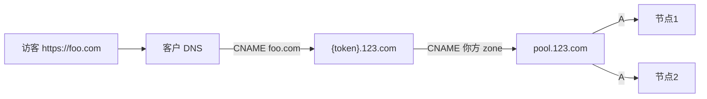
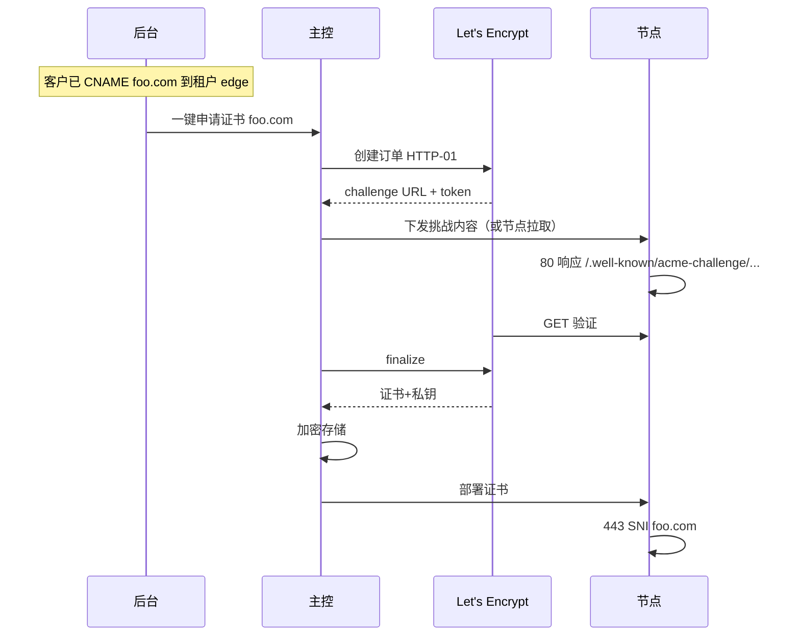

# 边缘 CNAME（模型 2）+ 主控证书（LE）+ 节点池 — 开发说明与进度

> **版本目标**：一期交付（不分多期上线）。本文档用于需求对齐、任务拆分与进度勾选。  
> **关联议题**：原「问题 3（HTTPS / 方案 C）」+「问题 4（租户 CNAME / 全平台单池）」。

---

## 一、总结（决策快照）

| 主题 | 结论 |
|------|------|
| 客户跳转域名 | 后台添加 **客户主域名**（如 `foo.com`），规范化存储，不以仅三级域为主 |
| 租户接入名 | 平台配置 **主域名 zone**（如 `123.com`），每租户 **随机 token**，生成 **`{token}.123.com`**，该租户下所有客户域名 **共用** 此 CNAME 目标 |
| DNS 模型 | **模型 2**：`{token}.123.com` → CNAME → **`pool.123.com`**；**仅在 pool 上维护多条 A** 指向节点公网 IP |
| 节点池 | **全平台一个池**，所有租户、所有域名共用同一批节点 |
| pool 解析 | **手动 + DNS API 并存**；API 根据后台 **节点 IP 列表** 同步 `pool` 的 A 记录 |
| DNS API | 抽象多驱动，一期实现：**Cloudflare**、**阿里云（中国+国际）**、**DNSPod（中国+国际）**、**dns.com**（按 API 文档实现，可并行排期） |
| HTTPS / 证书 | **方案 C（编排）**：主控统一向 Let's Encrypt 申请、**加密存储并下发全部在线节点**；验证方式见 **§1.1**（默认 **HTTP-01 一键**，类似 CDNFly） |
| 客户配合 | **仅 CNAME** `foo.com` → `{token}.123.com`（已满足跳转）；证书 **不要求** NS 委托、**默认不要求** 自添 TXT |
| lagran | 现仅 **80**；一期扩展支持 **443**（与 TLS 终结、证书挂载一并实现） |
| 节点直连 MySQL | **本期不改**为「主控 API 拉配置」；仍用 `REDI_DB_*`（与安全文档一致） |

**一期交付标准（验收）**：

1. 超级管理员可配置平台 zone、pool 主机名、DNS 模式与 API 凭证。  
2. 可维护节点列表；手动模式展示 pool 所需 A 列表；API 模式一键同步 pool 的 A。  
3. 新租户首次添加域名时自动分配 token，创建 `{token}.zone` → CNAME `pool.zone`（API 或提示手动）。  
4. 添加客户主域名后，面板展示 CNAME 指引；**CNAME 已生效** 后点「申请证书」→ 主控 + 节点完成验证 → 签发 → 部署到所有启用节点（**一键**，无 TXT）。  
5. 节点支持 **443 + SNI**，加载主控下发的证书；**80/443** 与 lagran 配置一致；`https://foo.com` 可完成跳转（与 HTTP 行为一致）。  

### 1.1 证书验证：为什么 CDNFly 能「一键」，之前写「客户自加 TXT」？

| 方式 | 客户要做什么 | 谁能自动完成 | 和本系统关系 |
|------|----------------|----------------|----------------|
| **NS 委托** | 把域名 NS 交给平台 | 平台改任意 DNS | 你已明确 **不做** |
| **DNS-01 + 客户手填 TXT** | 在 **客户 DNS** 加 `_acme-challenge` TXT | 无人自动（除非接客户 DNS API） | 之前按你「客户自己添加」写的 **兜底路径**，**不是主路径** |
| **DNS-01 + 平台 zone** | 无 | 只能给 **你拥有的** 主机名（如 `pool.123.com`）签证 | **不能**单独用于客户 `foo.com` |
| **HTTP-01** | 域名 **已解析到你节点**（客户 CNAME 即可） | 节点在 **80** 响应 `/.well-known/acme-challenge/...` | **与 CDNFly 同类**：一点申请，**前提：foo.com 已 CNAME 到池** |
| **DNS-01 CNAME 委派** | 有时需加一条 `_acme-challenge` CNAME 到你方（仅验证期） | 你方 zone 自动 TXT | 可选增强；仍非 NS 委托 |

**结论（一期默认）**：

- **「方案 C」** 指 **主控统一 ACME + 存证 + 下发节点**，不等于必须用 DNS-01。  
- **主路径：HTTP-01** — 客户只做跳转所需的 **CNAME**；后台点「申请证书」后，主控向 LE 下单，**各节点临时提供验证文件**，通过后签发并下发（体验对齐 CDNFly）。  
- **备路径**（主路径失败时 UI 提示）：客户 **手填 TXT**（DNS-01），或后续 **客户 DNS API**（仍非 NS 委托）。

**注意**：HTTP-01 要求申请时 `http://foo.com` 已指向你的节点且 **80 可达**；未 CNAME 前点申请应提示「先完成解析」。根域 CNAME 受限的厂商，可能仍需 TXT 或 ALIAS，文档单独说明。

---

## 二、架构

### 2.1 DNS 与流量



### 2.2 证书与主控（默认 HTTP-01）



### 2.3 节点进程（目标）

```text
[443 TLS + SNI] ─┐
[80  HTTP/lagran]─┼─► 跳转逻辑（现有 redirect + api.js 查库）
                 │
[8080 api.js]   ─┘   （可逐步改为仅内网或同机回环）
```

---

## 三、数据模型（主控 MySQL）

### 3.1 新增表（建议）

| 表名 | 用途 |
|------|------|
| `redi_platform_dns` | 平台 DNS：zone、pool_host、mode(manual/api)、api_driver、api_credentials(加密 JSON)、zone_id 等 |
| `redi_nodes` | 节点：name、public_ip、enabled、sort、last_heartbeat_at、agent_version、备注 |
| `redi_tenant_edge` | 租户边缘：`admin_id` UNIQUE、`token`、`edge_fqdn`、`dns_synced_at` |
| `redi_domain_certs` | 证书：`domain_id` 或 `original_url`、`status`、`expires_at`、`challenge_txt`、加密 cert/key、deploy_version、last_error |
| `redi_cert_deployments` | 节点部署状态：`cert_id`、`node_id`、`status`、`deployed_at`、`error` |
| `redi_dns_sync_logs` | DNS API 同步日志（可选，排错） |

### 3.2 现有表变更

| 表 | 变更 |
|----|------|
| `redi_admin_domain` | 可选：`force_https` tinyint、`cert_id` FK；列表展示 CNAME/证书状态 |
| `admin_settings` | 若已有平台外观，与 `redi_platform_dns` 二选一或合并（推荐独立表） |

### 3.3 索引与约束

- `redi_tenant_edge.admin_id` UNIQUE  
- `redi_domain_certs` 对 `(admin_id, original_url)` 或 `domain_id` UNIQUE  
- 节点 `public_ip` 唯一（可选）

---

## 四、主控后台功能

### 4.1 菜单（建议）

| 菜单 | 权限 | 功能 |
|------|------|------|
| 站点配置 → **DNS 与节点池** | 超级管理员 | zone、pool、手动/API、凭证、同步 pool |
| 站点配置 → **节点管理** | 超级管理员 | CRUD 节点 IP、启用、展示同步结果 |
| 站点配置 → **系统外观** | 已有 | 不变 |
| 域名管理 | 租户 | 加域名、看 **CNAME 目标**、一键申请证书 / 证书状态 |

### 4.2 平台 DNS 与节点池页

- [ ] 平台主域名 zone（如 `123.com`）  
- [ ] Pool 主机名（默认 `pool`，FQDN = `pool.123.com`）  
- [ ] 解析模式：手动 / API  
- [ ] API：驱动选择、凭证表单、测试连接、Zone ID  
- [ ] 节点列表只读摘要 + 跳转节点管理  
- [ ] 按钮：**同步 pool 到 DNS**（API 模式）  
- [ ] 手动模式：展示「请为 pool 添加以下 A」+ 复制  

### 4.3 节点管理页

- [ ] 增删改节点公网 IP、启用/停用  
- [ ] 保存后提示：手动请改 DNS / API 可点同步  
- [ ] （可选）节点 Agent 心跳、证书数量、443 是否正常  

### 4.4 租户边缘名（自动化）

- [ ] 租户 **首次** 创建域名或首次登录业务时生成 `token`（长度、字符集：小写 alphanumeric）  
- [ ] 写入 `redi_tenant_edge`，展示 **CNAME 目标** `{token}.{zone}`  
- [ ] API 模式：自动创建 `{token}` CNAME → `pool.{zone}`  
- [ ] 手动模式：文档说明两条记录（token CNAME pool + pool 的 A）  

### 4.5 域名管理增强

- [ ] `original_url` 强制主域风格（根域 `foo.com`，与现有 normalizer 一致）  
- [ ] 列表/表单：**本账号 CNAME 目标**（只读复制）  
- [ ] 按钮 **申请证书** / **启用 HTTPS**（创建 `redi_domain_certs` 任务）  
- [ ] 状态机：待解析 → 验证中(HTTP-01) → 已签发 → 部署中 → 已部署 / 失败  
- [ ] 失败时：展示原因；可选切换 **DNS-01 手动 TXT** 指引（备路径）  
- [ ] **重新申请**、**强制 HTTPS**（仅已部署后可开）  
- [ ] HTTP→HTTPS 跳转（80 响应 301 或跳转页逻辑，与 lagran 协调）  

### 4.6 证书服务（主控）

- [ ] ACME 客户端（Laravel 队列 Job；库选型实现阶段定）  
- [ ] **HTTP-01（默认）**：主控下单 → 节点提供 challenge 响应（80 专用路径，与跳转共存）  
- [ ] **DNS-01（备）**：展示 TXT，客户手填后轮询  
- [ ] 轮询验证（队列 + 退避）  
- [ ] 私钥与证书 **加密 at rest**（`APP_KEY` 或专用 key）  
- [ ] 续期：cron 每日检查 `<30d` 续签 → 再部署  
- [ ] 节点 API：认证（节点 token）拉取证书列表或按域名增量  

---

## 五、DNS 驱动（一期）

| 驱动 | 能力 | 进度 |
|------|------|------|
| `manual` | 仅 UI 文案 | [ ] |
| `cloudflare` | A 记录集同步 pool；CNAME token→pool | [ ] |
| `aliyun_cn` / `aliyun_intl` | 同上 | [ ] |
| `dnspod_cn` / `dnspod_intl` | 同上 | [ ] |
| `dns_com` | 同上 | [ ] |

**接口抽象**（PHP）：

```text
DnsProviderInterface::upsertARecords(fqdn, ipv4[])
DnsProviderInterface::upsertCname(name, target)
DnsProviderInterface::testConnection()
```

同步策略：**replace 式** — pool 的 A = 当前所有 `enabled=1` 节点 IP。

---

## 六、节点（redi-multi）改造

### 6.1 Agent / 配置

- [ ] 环境变量：`REDI_MASTER_URL`、`REDI_NODE_TOKEN`、`REDI_NODE_ID`  
- [ ] 启动注册/心跳（主控写 `redi_nodes.last_heartbeat_at`）  
- [ ] 定时拉取证书 bundle（或主控推送 webhook，一期 **拉取** 即可）  
- [ ] 本地目录存储 PEM（权限 600），热加载  

### 6.2 TLS 443

- [ ] 监听 `0.0.0.0:443`（可配置）  
- [ ] **SNI** 选择证书（客户主域名）  
- [ ] 无证书时：可选拒绝握手或默认证书（产品：仅对已签发域名提供服务）  
- [ ] TLS 后进入与 80 相同的 redirect 逻辑（或内网回环到统一 handler）  

### 6.3 lagran

- [ ] `config.json` / lagran `port` 支持 **80 与 443**（字符串或数组，实现时统一）  
- [ ] `setIptable` / `UnsetIptable` 对两端口均 append/delete 规则  
- [ ] 与 TLS 层顺序：实现阶段确定（TLS 终止在 Go 内则 lagran 针对 443 sport；若前置代理则 lagran 可能仅 80）  

### 6.4 跳转页与 api.js

- [ ] HTTPS 页面中脚本 URL 改为 **https** 或相对协议（`//host:8080` → 建议 **同 host 443 反代 api** 或 `https://{server_ip}:8080`）  
- [ ] 避免混合内容导致浏览器拦截  

### 6.5 强制 HTTPS

- [ ] 主控 `force_https` 标记同步到节点（查库或缓存）  
- [ ] 80 上对已强制域名返回 301 Location `https://...`  

---

## 七、API 草案（主控 ↔ 节点）

| 方法 | 路径 | 说明 |
|------|------|------|
| POST | `/api/nodes/register` | 首次 token + IP |
| POST | `/api/nodes/heartbeat` | 存活 |
| GET | `/api/nodes/{id}/certificates` | 返回该节点应安装的 cert 列表（id, domains, pem） |
| POST | `/api/nodes/{id}/certificates/{cert_id}/ack` | 部署成功/失败 |

认证：`Authorization: Bearer {REDI_NODE_TOKEN}`，主控为每个节点生成 secret。

---

## 八、任务总表（一期 — 进度勾选）

> 整体进度：**0 / N**（开发时更新标题或本节首行）

### A. 主控基础与数据

- [ ] A1 迁移：新表 + `redi_admin_domain` 字段  
- [ ] A2 Model / Service：`PlatformDns`、`TenantEdge`、`Node`、`DomainCert`  
- [ ] A3 超级管理员策略与菜单  
- [ ] A4 平台 DNS 与 pool 配置页  
- [ ] A5 节点管理 CRUD  
- [ ] A6 租户 token 生成与 edge FQDN  
- [ ] A7 域名表单/列表 CNAME 展示  
- [ ] A8 DNS 手动指引文案  

### B. DNS API

- [ ] B1 `DnsProviderInterface` + 工厂  
- [ ] B2 Cloudflare 实现 + 测试  
- [ ] B3 阿里云中国版  
- [ ] B4 阿里云国际版  
- [ ] B5 DNSPod 中国版  
- [ ] B6 DNSPod 国际版  
- [ ] B7 dns.com  
- [ ] B8 同步 pool A + 创建 tenant CNAME 编排  
- [ ] B9 同步日志与错误提示  

### C. 证书（ACME，默认 HTTP-01）

- [ ] C1 证书状态机与表  
- [ ] C2 一键申请 UI + 解析是否指向池的预检（dig）  
- [ ] C3 HTTP-01：挑战下发节点 + 验证 Job  
- [ ] C3b DNS-01 备路径：TXT 展示 + 轮询 Job  
- [ ] C4 签发入库加密  
- [ ] C5 续期定时任务  
- [ ] C6 节点证书 API  
- [ ] C7 部署状态 `redi_cert_deployments`  
- [ ] C8 域名「强制 HTTPS」开关逻辑  

### D. 节点程序

- [ ] D1 主控 URL + token 配置  
- [ ] D2 心跳与注册  
- [ ] D3 证书拉取与本地存储  
- [ ] D4 TLS 443 + SNI  
- [ ] D5 lagran 443 扩展  
- [ ] D6 redirect/HTML 避免混合内容  
- [ ] D7 80→443 强制跳转  
- [ ] D8 打包 `redi-multi.tar.gz` + 文档  

### E. 数据库种子与部署

- [ ] E1 更新 `db/redi_admin.sql`（若需新菜单则合并进全量 SQL，**不单独立补丁说明**）  
- [ ] E2 更新 `DEPLOY.md` / `DEPLOY-centos7.md`（节点 env、443 防火墙）  
- [ ] E3 `SECURITY.md` 补充节点 token、证书存储  

### F. 测试与验收

- [ ] F1 手动 DNS：pool 多 A + token CNAME pool  
- [ ] F2 API 同步 pool（至少 1 家驱动）  
- [ ] F3 客户域 CNAME → HTTP 跳转  
- [ ] F4 HTTP-01 一键签发 → 443 跳转  
- [ ] F4b DNS-01 TXT 备路径演练  
- [ ] F5 强制 HTTPS  
- [ ] F6 续期演练  
- [ ] F7 新增节点后 pool 同步与证书全量部署  

---

## 九、风险与依赖

| 风险 | 缓解 |
|------|------|
| 客户根域 CNAME 限制 | 文档说明 ALIAS/ANAME；不支持厂商列表 |
| 未 CNAME 就点申请 | 预检失败，提示先完成 CNAME |
| HTTP-01 与 80 跳转/lagran 冲突 | 实现阶段：优先精确匹配 `/.well-known/` 再走跳转 |
| lagran 与 TLS 顺序复杂 | 开发早期在测试机验证 80/443 共存 |
| 多 DNS 驱动工期 | 一期可先 **CF + 1 家国内** 上线驱动框架，其余驱动同接口补齐 |
| 节点证书泄露 | 传输 TLS + token；磁盘权限；私钥仅节点与主控 |

---

## 十、文档维护

| 日期 | 变更 |
|------|------|
| 2026-03-28 | 初稿：一期范围、模型 2、方案 C、任务表 |
| 2026-03-28 | 证书：默认 HTTP-01 一键（CDNFly 同类）；DNS-01 TXT 为备路径 |

**进度更新约定**：每完成一项，将 `[ ]` 改为 `[x]`，并更新 **第八节** 首行计数；PR 关联任务编号（如 `A4`）。

---

## 十一、与现有仓库模块关系

| 路径 | 本期改动 |
|------|----------|
| `master/` | 后台、ACME、DNS 驱动、节点 API |
| `node/redi-multi/` | TLS、Agent、lagran 443、redirect |
| `db/redi_admin.sql` | 新表数据或迁移后合并全量 |
| `docs/` | 本文档 |

**刻意不做（一期）**：NS 委托；按租户分池；主控替代 MySQL 给节点下发跳转规则。  
**可选后续**：客户 DNS API 代填 TXT（仍非 NS 委托）。
