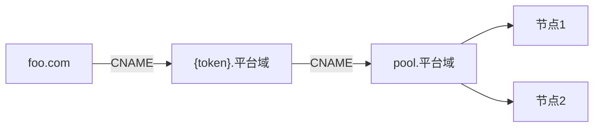

# 平台架构与能力说明

部署步骤见 [DEPLOY.md](../DEPLOY.md)、[DEPLOY-centos7.md](../DEPLOY-centos7.md)；后台操作见 [CONSOLE.md](CONSOLE.md)。业务验收见 [ACCEPTANCE-EDGE-POOL.md](ACCEPTANCE-EDGE-POOL.md)（F1–F8）。

## 能力范围

| # | 项 | 说明 |
|---|-----|------|
| 1 | 客户域名 | **主域名**（如 `foo.com`） |
| 2 | 租户 CNAME | 平台 zone + 随机 token → **`{token}.平台域`**；同一租户下域名共用此 CNAME 目标 |
| 3 | DNS 模型 | **模型 2**：`{token}` CNAME → **`pool.平台域`**；**只在 pool 上挂全部节点 A**（可选 AAAA，见 [NETWORKING-IPv6.md](NETWORKING-IPv6.md)） |
| 4 | 节点池 | **全平台一个池**；后台维护节点公网 IP |
| 5 | pool 解析 | **手动 + DNS API**；API 用节点列表同步 pool 的 A/AAAA |
| 6 | DNS 厂商 | Cloudflare、阿里云（中/国际）、DNSPod（中/国际）、dns.com |
| 7 | 证书 | 主控 ACME、加密存证、下发全部启用节点 |
| 8 | 验证方式 | **HTTP-01**；客户 **只做 CNAME**（不做 NS 委托、不做逐域 TXT 主流程） |
| 9 | 跳转面 | **lagran 80 + 443**；节点仍直连 MySQL（`REDI_DB_*`） |
| 10 | 数据库 | 绿场：**`db/redi_admin.sql` 全量导入**（见 [GREENFIELD-INSTALL.md](GREENFIELD-INSTALL.md)） |

## 产品行为（非缺陷）

- 正常跳转：**HTTP 200 + JS**，不是业务层 301。
- **强制 HTTPS**：TLS 层 301。
- 「抢注」指平台内 `original_url` 唯一；新建默认停用 + 启用前 DNS 预检。

## DNS（模型 2）

| 角色 | 操作 |
|------|------|
| 超管 | zone、pool、DNS 手动/API、节点 IP、同步 pool |
| 租户 | 加主域名；复制 CNAME；申请/批量证书；可选强制 HTTPS |
| 客户 | 仅 DNS：CNAME |

DNS 模式：**手动**（参考表，无同步按钮）或 **API 自动**（一键同步 pool A + 租户 CNAME）。

## 数据模型（摘要）

| 表 | 说明 |
|----|------|
| `redi_platform_dns` | zone、pool、manual/api、driver、credentials |
| `redi_nodes` | IP、enabled、token、heartbeat |
| `redi_tenant_edge` | admin_id、token、edge_fqdn |
| `redi_domain_certs` | domain_id、status、expires、加密 pem |
| `redi_cert_deployments` | cert_id、node_id、status |
| `redi_admin_domain` | force_https、证书状态展示 |

## 节点（redi-multi）

- **HTTP/HTTPS**：`addr` / `tls_addr`（默认 `0.0.0.0`；Linux 上已双栈接听）。
- **lagran**：`lagran.port` 建议 `80,443`；需 CAP_NET_ADMIN。
- **8080**：管理口输出 `api.js` / `c.js`；跳转页用相对路径 `/c.js`、`/api.js`（HTTPS 不混用 `IP:8080`）。

### Master Agent（`REDI_MASTER_URL` + `REDI_NODE_TOKEN`）

约 5 秒一轮（缺 env 则不启动）：`register` → `revision` → 按需拉 challenges / redirect-rules / certificates → `heartbeat` → 证书安装后 `ack`。主控故障时轮询退避至 60s；空证书列表默认连续 3 次拉取后才清空本机 TLS 内存（`REDI_AGENT_EMPTY_CERT_CLEAR_AFTER`）。

### 80/443 处理顺序

1. `/.well-known/acme-challenge/*` 明文 200  
2. `/c.js`、`/api.js`  
3. 强制 HTTPS → 301  
4. 跳转 HTML  

## 主控 ↔ 节点 API

鉴权：`Authorization: Bearer {节点ID}.{Secret}`。前缀 `/api/nodes/*`。

| 方法 | 路径 | 说明 |
|------|------|------|
| POST | `/register` | 心跳与版本 |
| GET | `/revision` | 分项 revision 摘要 |
| POST | `/heartbeat` | 心跳 |
| POST | `/challenges-synced` | 已应用 ACME 挑战 |
| GET | `/acme-challenges` | 有效 HTTP-01 挑战 |
| GET | `/certificates` | 本节点可拉取证书 PEM |
| POST | `/ack` | 证书安装结果 |
| GET | `/redirect-rules` | `original_url`、`force_https` |

跳转目标由节点 **MySQL 过程** `/api.js` 提供，不经 redirect-rules API。

HTTP-01 签发前：至少一台在线节点在窗口内 `challenges-synced`，且公网 `http://客户域/.well-known/...` 可达。

## 明确不支持

NS 委托；多 pool；逐域 TXT 主流程；客户自带 DNS API；主控替代 MySQL 提供跳转规则。

## 运营注意

| 项 | 说明 |
|----|------|
| LE 限流 | 批量入队间隔；全局单 ACME 任务 |
| 主控队列 | `QUEUE_CONNECTION` 须 database/redis，勿长期 sync |
| HTTP-01 vs lagran | `/.well-known/` 必须优先于跳转 |
| 根域 CNAME | 部分厂商不支持；见 [CUSTOMER-CNAME-HTTPS.md](CUSTOMER-CNAME-HTTPS.md)（ALIAS/ANAME） |
| DNS API 部分失败 | 可能已写入部分记录；按 CONSOLE「同步失败后的检查」修正后重试 |
