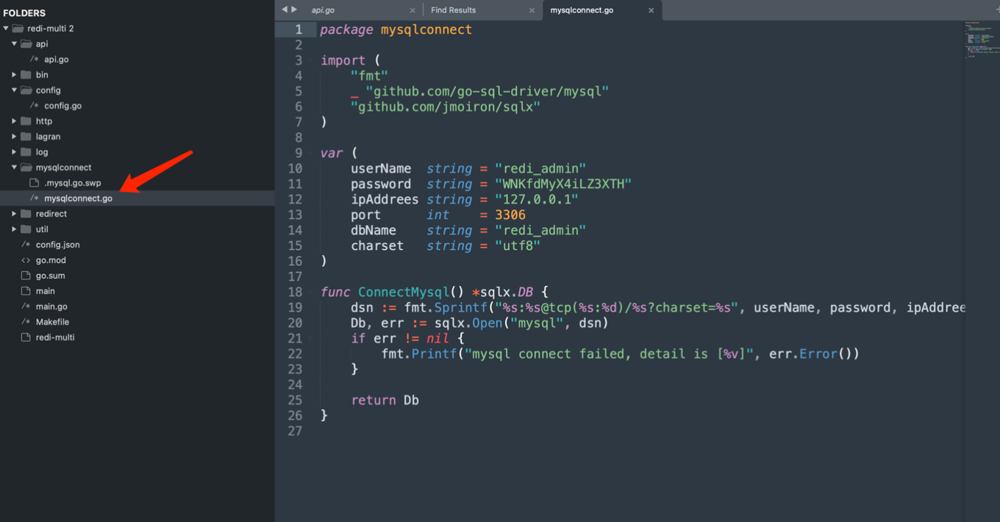

# Go 的安装与 301 跳转程序部署

出处：http://www.topgoer.com/开发环境/go的安装.html

## 1.1. 下载地址

Go官网下载地址：https://golang.org/dl/

Go语言资源站：https://studygolang.com/dl

## 1.2. Linux下安装

1. SSH远程登录你的linux服务器  
2. 安装 mercurial包：

```bash
yum install mercurial -y
```

3. 安装git包：

```bash
yum install git -y
```

4. 安装gcc：

```bash
yum install gcc -y
```

5. 下载Go的压缩包:(可选择最新的Go版本)

```bash
cd /usr/local/
wget https://go.dev/dl/go1.20.2.linux-amd64.tar.gz
```

注意：如果不能翻墙，去go语言资源站 下载相应的包。然后通过ftp上传到此目录。

6. 下载完成 or ftp上传完成，用tar 命令来解压压缩包。

```bash
tar -zxvf go1.20.2.linux-amd64.tar.gz
```

7. 建立Go的工作空间（workspace，也就是GOPATH环境变量指向的目录）

GO代码必须在工作空间内。工作空间是一个目录，其中包含三个子目录：

- src ---- 里面每一个子目录，就是一个包。包内是Go的源码文件  
- pkg ---- 编译后生成的，包的目标文件  
- bin ---- 生成的可执行文件  

这里，我们在/home目录下, 建立一个名为go(可以不是go, 任意名字都可以)的文件夹， 然后再建立三个子文件夹(子文件夹名必须为src、pkg、bin)。

```text
[root@localhost local]# cd /home/
[root@localhost home]# mkdir go
[root@localhost home]# cd go/
[root@localhost go]# mkdir bin src pkg
```

8. 添加PATH环境变量and设置GOPATH环境变量

```bash
vi /etc/profile
```

加入下面这三行:

```bash
export GOROOT=/usr/local/go
export PATH=$GOROOT/bin:$PATH
export GOPATH=/home/go
```

保存后，执行以下命令，使环境变量立即生效:

```bash
source /etc/profile
```

至此，Go语言的环境已经安装完毕。

9. 验证一下是否安装成功，如果出现下面的信息说明安装成功了

```text
[root@localhost go]# go version
go version go1.20.2 linux/amd64
```

10. 查看Go语言的环境信息

```text
[root@localhost go]# go env
```

## 1.3. 清空防护墙的规则

```bash
systemctl status firewalld.service
systemctl stop firewalld.service
iptables -nvL
iptables -F   # 清空所有的防火墙规则
iptables -X   # 删除用户自定义的空链
iptables -Z   # 清空计数
```

## 1.4. 配置301跳转服务器

把源文件redi-multi复制到/home/go/src目录里面：

```bash
cp redi-multi.zip /home/go/src
cd /home/go/src
unzip redi-multi.zip
cd redi-multi
```

## 1.5. 修改源文件中的数据库IP地址为后台IP




## 1.6. 修改源文件中config.json的IP地址为跳转服务器的外网IP


## 1.7. 启动301跳转程序

```bash
cd /home/go/src/redi-multi
nohup go run main.go &
```

---

## 节点包与「跳转次数」统计

主控域名列表的 **跳转次数**（`skip_num`）由节点在 `GET /api.js?d=...` 时写库。本仓库 `node/` 下三个包对比如下：

| 文件 | 是否递增 `skip_num` | 说明 |
|------|---------------------|------|
| `redi-multi.tar.gz` | **是** | `api/api.go` 中查询跳转后执行 `UPDATE ... skip_num=skip_num+1` |
| `redi-multi_Yk7RxC.tar.zip` | **是** | 与上同为标准节点（内层 tar 代码一致） |
| `redi-multi-mysql版.zip` | **否** | 仅查询跳转 URL，**不更新** `skip_num`，不适合需要统计的场景 |

需要点击/跳转统计时，请部署 **redi-multi.tar.gz** 或 **redi-multi_Yk7RxC.tar.zip**，并确保节点 `mysqlconnect` 连接的是主控同一库 `redi_admin`。
