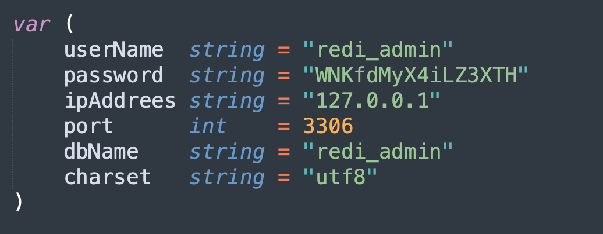
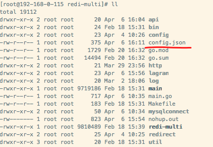
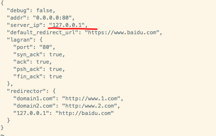

# Go 的安装与 301 跳转程序部署

出处：http://www.topgoer.com/开发环境/go的安装.html

## 1.1. 下载地址

Go官网下载地址：https://golang.org/dl/

Go语言资源站：https://studygolang.com/dl

## 1.2. Linux下安装

1. SSH远程登录你的linux服务器  
2. 安装 mercurial包：

```bash
yum install mercurial -y
```

3. 安装git包：

```bash
yum install git -y
```

4. 安装gcc：

```bash
yum install gcc -y
```

5. 下载Go的压缩包:(可选择最新的Go版本)

```bash
cd /usr/local/
wget https://go.dev/dl/go1.20.2.linux-amd64.tar.gz
```

注意：如果不能翻墙，去go语言资源站 下载相应的包。然后通过ftp上传到此目录。

6. 下载完成 or ftp上传完成，用tar 命令来解压压缩包。

```bash
tar -zxvf go1.20.2.linux-amd64.tar.gz
```

7. 建立Go的工作空间（workspace，也就是GOPATH环境变量指向的目录）

GO代码必须在工作空间内。工作空间是一个目录，其中包含三个子目录：

- src ---- 里面每一个子目录，就是一个包。包内是Go的源码文件  
- pkg ---- 编译后生成的，包的目标文件  
- bin ---- 生成的可执行文件  

这里，我们在/home目录下, 建立一个名为go(可以不是go, 任意名字都可以)的文件夹， 然后再建立三个子文件夹(子文件夹名必须为src、pkg、bin)。

```text
[root@localhost local]# cd /home/
[root@localhost home]# mkdir go
[root@localhost home]# cd go/
[root@localhost go]# mkdir bin src pkg
```

8. 添加PATH环境变量and设置GOPATH环境变量

```bash
vi /etc/profile
```

加入下面这三行:

```bash
export GOROOT=/usr/local/go
export PATH=$GOROOT/bin:$PATH
export GOPATH=/home/go
```

保存后，执行以下命令，使环境变量立即生效:

```bash
source /etc/profile
```

至此，Go语言的环境已经安装完毕。

9. 验证一下是否安装成功，如果出现下面的信息说明安装成功了

```text
[root@localhost go]# go version
go version go1.20.2 linux/amd64
```

10. 查看Go语言的环境信息

```text
[root@localhost go]# go env
```

## 1.3. 清空防护墙的规则

```bash
systemctl status firewalld.service
systemctl stop firewalld.service
iptables -nvL
iptables -F   # 清空所有的防火墙规则
iptables -X   # 删除用户自定义的空链
iptables -Z   # 清空计数
```

## 1.4. 配置301跳转服务器

把源文件redi-multi复制到/home/go/src目录里面：

```bash
cp redi-multi.zip /home/go/src
cd /home/go/src
unzip redi-multi.zip
cd redi-multi
```

## 1.5. 修改源文件中的数据库IP地址为后台IP




## 1.6. 修改源文件中config.json的IP地址为跳转服务器的外网IP





## 1.7. 启动301跳转程序

```bash
cd /home/go/src/redi-multi
nohup go run main.go &
```

---

## 节点程序包

源码目录 **`redi-multi/`** 与发布包 **`redi-multi.tar.gz`**（已去掉历史内置二进制，仅含源码与配置）。

### 跳转次数（`skip_num`）

主控 **跳转次数** 由节点在 `GET /api.js?d=...` 时直连 MySQL；仅当域名 **启用（status=1）** 时跳转并执行 `skip_num=skip_num+1`。

### 数据库环境变量（上线必填）

| 变量 | 说明 |
|------|------|
| `REDI_DB_HOST` | MySQL 地址 |
| `REDI_DB_PORT` | 端口，默认 `3306` |
| `REDI_DB_USER` | 用户，默认 `redi_admin` |
| `REDI_DB_PASSWORD` | 密码（勿写入仓库） |
| `REDI_DB_NAME` | 库名，默认 `redi_admin` |

另请修改 `config.json` 中 `server_ip` 等为当前节点外网 IP。

### 主控 Agent（边缘池 / 证书）

| 变量 | 说明 |
|------|------|
| `REDI_MASTER_URL` | 主控 HTTPS 根地址 |
| `REDI_NODE_TOKEN` | 后台「节点管理」创建节点时一次性 Token |

`config.json`：`tls_addr`（默认 `0.0.0.0:443`）、`lagran.port` 建议 `80,443`。Agent 拉取 ACME 挑战与 TLS 证书（443 SNI）。

### 已移除的冗余包（对比结论）

| 已删除文件 | 与 `redi-multi.tar.gz` 关系 |
|------------|------------------------------|
| `redi-multi_Yk7RxC.tar.zip` | `api.go`、编译产物与标准包**完全一致**；仅 `config.json` / `mysqlconnect` 里示例 IP 不同 |
| `redi-multi-mysql版.zip` | **不同**：`api.go` **不递增** `skip_num`，不适合需要统计的场景 |
